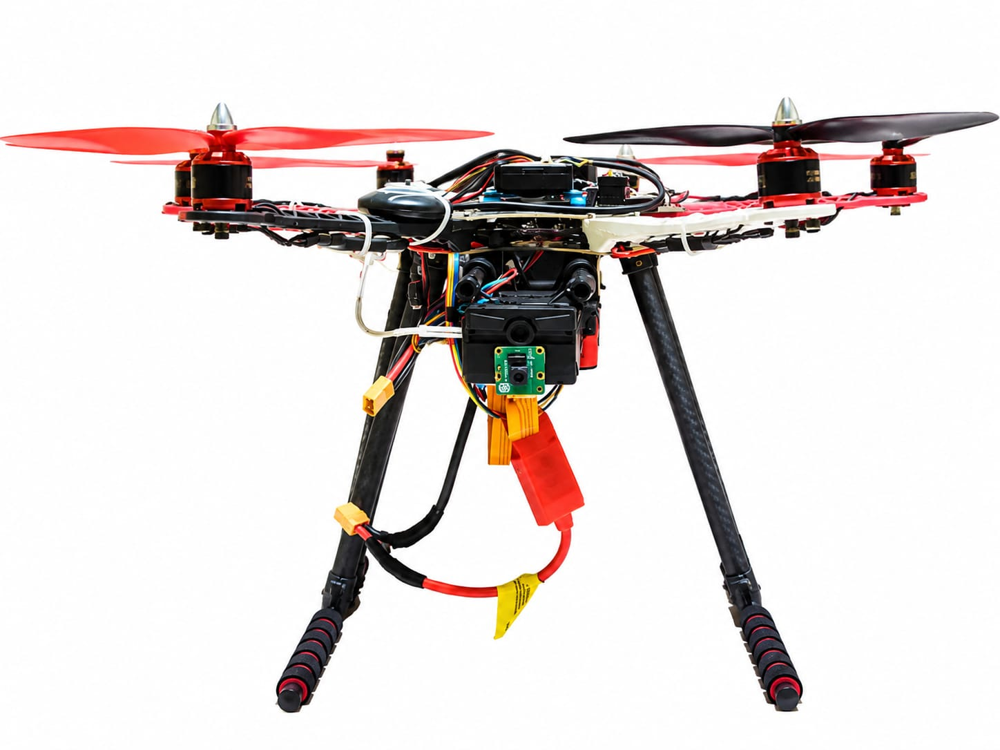
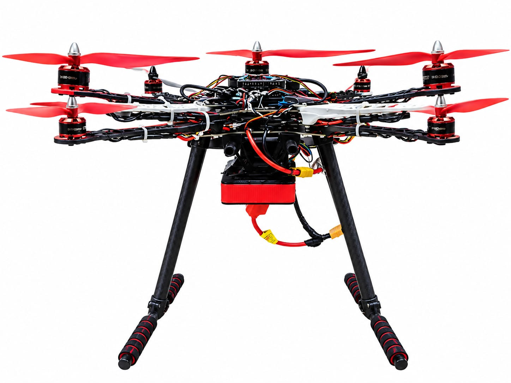
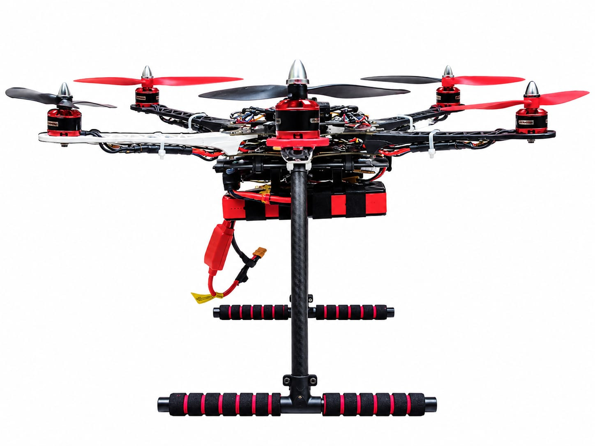
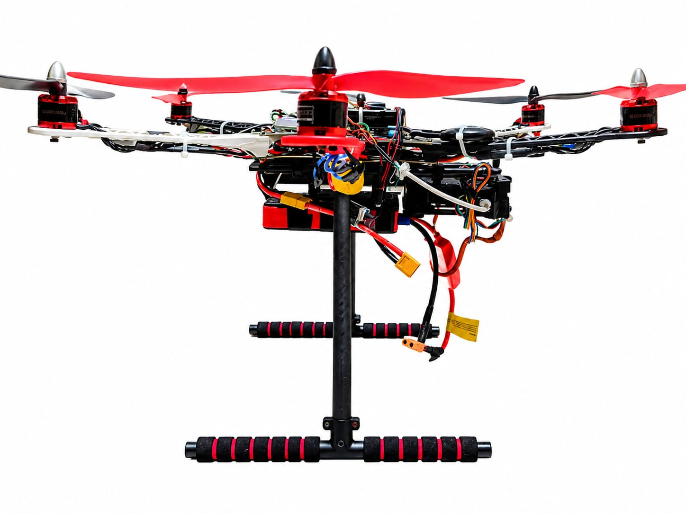
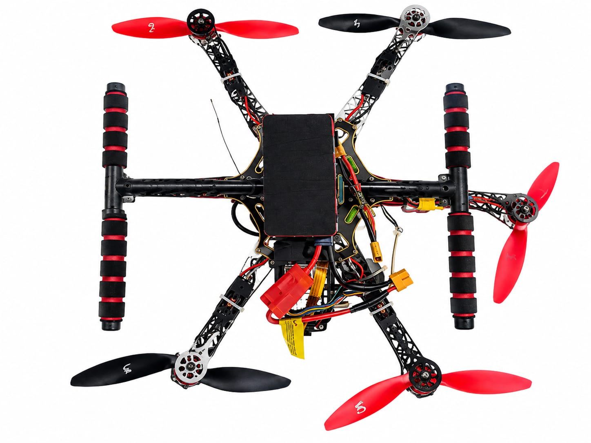

# Skynetic's
Aerofix es un proyecto desarrollado por Skynetic's, un equipo guatemalteco que participa en la WRO 2026 rumbo a Puerto Rico. 🇬🇹

## TEAM MEMBERS 🩷
•Melanny Jimena Lisseth Muralles Estrada (Programadora principal)

•Kyrsten Arlette Nicole Márquez Escobar (diseñadora principal)

•Stefany Andrea Tobar de Paz
 (electrónica principal)

Somos Skynetic's, un equipo guatemalteco de jóvenes apasionadas por la tecnología, la robótica y la innovación. Unimos nuestras habilidades en programación, electrónica y diseño para crear soluciones que generen un impacto positivo, siempre con el deseo de aprender, superar nuevos retos y demostrar el talento joven de Guatemala en la WRO 2026. 🇬🇹

## Tabla de contenidos 

-[¿Que es Aerofix?](#Que-es-Aerofix)

-[vistas del robot](#Vistas-del-robot)

-[Problemática](#Problematica)

-[¿Por que elegimos desarrollar un dron?](#por-que-elegimos-desarrollar-un-dron)

-[Objetivo general](#Objetivo-general)

-[Objetivos especificos](#Objetivos-especifcos)
-[¿como funciona aerofix?](#como-funciona-aerofix)

## ¿Que es Aerofix?

Aerofix es un sistema robótico aéreo autónomo desarrollado por el equipo Skynetic's, que integra tecnología de vuelo, electrónica, visión artificial e inteligencia artificial para realizar inspecciones visuales de estructuras históricas. Está compuesto por una plataforma aérea equipada con sistemas de captura de imágenes, procesamiento computacional y componentes electrónicos que permiten ejecutar las diferentes funciones del sistema.

El dron incorpora una cámara que captura imágenes de las superficies durante el proceso de inspección. Estas imágenes son procesadas mediante herramientas de visión artificial e inteligencia artificial, que permiten identificar posibles grietas y analizar sus características. A partir de este procesamiento, el sistema clasifica los hallazgos en tres niveles: leve, crítica y urgente, de acuerdo con los criterios de clasificación establecidos en el proyecto.

Aerofix también integra Aerofissure, una aplicación complementaria que funciona como interfaz de visualización y consulta de los resultados obtenidos durante las inspecciones. A través de ella, se presentan los hallazgos identificados, su clasificación y las recomendaciones correspondientes a cada nivel de gravedad. Estas recomendaciones están fundamentadas en documentación técnica y criterios de evaluación estadounidenses utilizados como referencia dentro del proyecto.

Además, Aerofissure incorpora un sistema de notificaciones por voz que comunica los resultados y las alertas generadas durante el análisis, facilitando el acceso a la información sin depender exclusivamente de la visualización de la pantalla.

En conjunto, Aerofix está conformado por una plataforma aérea, un sistema electrónico y computacional para la captura y el procesamiento de imágenes, herramientas de inteligencia artificial y una aplicación de gestión de resultados. Estos elementos trabajan de manera integrada para desarrollar el proceso de inspección y presentar la información obtenida.

## VISTAS DEL ROBOT

| VISTA FRONTAL | VISTA TRASERA |
|:---:|:---:|
|  |  |

| LADO IZQUIERDO | LADO DERECHO |
|:---:|:---:|
|  |  |

| VISTA SUPERIOR | VISTA INFERIOR |
|:---:|:---:|
|  |  |

## Problematica 

En cada rincón del mundo existen estructuras que guardan parte de nuestra historia: monumentos, templos, sitios arqueológicos y edificaciones que han permanecido durante generaciones. Sin embargo, el paso del tiempo no siempre las trata con cuidado.

La humedad, los cambios climáticos, la contaminación y el desgaste de los materiales provocan daños que pueden comenzar con pequeñas grietas y evolucionar hasta comprometer la conservación de una estructura. Muchas veces, estos deterioros pasan desapercibidos o se encuentran en zonas de difícil acceso, haciendo más compleja su inspección y seguimiento.

Pero cuando una estructura histórica se pierde, no desaparecen únicamente sus paredes: también se pierde una parte de la memoria, la identidad y las historias que representa. Porque detrás de cada monumento hay un legado que no puede reconstruirse una vez perdido.

## ¿Por que elegimos desarrollar un dron?

Al analizar las dificultades que presenta la inspección de estructuras históricas, consideramos que necesitábamos una herramienta capaz de desplazarse y capturar imágenes desde diferentes perspectivas, incluso en zonas elevadas o de difícil acceso. Por ello, elegimos desarrollar un dron: una plataforma aérea que permite acercarse a distintas superficies sin depender de andamios o de que una persona tenga que acceder físicamente a cada punto de inspección.

A diferencia de una cámara fija o de una herramienta de inspección terrestre, un dron puede desplazarse alrededor de una estructura, modificar su posición y obtener imágenes desde distintos ángulos. Esto permite ampliar la cobertura visual y documentar áreas que podrían pasar desapercibidas durante una observación convencional.

Además, al integrar una cámara con herramientas de visión artificial e inteligencia artificial, convertimos el dron en parte de un sistema de análisis, en lugar de utilizarlo únicamente para capturar fotografías.

Elegimos un dron porque queríamos llevar la tecnología hasta aquellos lugares donde la observación humana puede resultar limitada, combinando movilidad aérea, procesamiento inteligente de imágenes y análisis digital en una sola solución.

## Objetivo general

Contribuir a la preservación del patrimonio histórico y cultural de la humanidad mediante la aplicación de tecnologías robóticas e inteligencia artificial que permitan identificar oportunamente posibles daños en estructuras históricas, facilitando su inspección, seguimiento y evaluación, para que las huellas de nuestro pasado no desaparezcan con el tiempo y las futuras generaciones puedan conocer, valorar y conservar aquello que cuenta la historia de quienes somos.

## Objetivos especificos

1. Facilitar la inspección visual de estructuras históricas, incluyendo aquellas que presentan zonas elevadas o de difícil acceso.

2. Favorecer la identificación oportuna de grietas y otros indicios de deterioro que puedan requerir una evaluación especializada.

3. Proporcionar información organizada sobre los daños identificados para facilitar su seguimiento y priorización.

4. Promover el uso de la robótica y la inteligencia artificial como herramientas de apoyo en la conservación del patrimonio cultural.

5. Contribuir a la protección de la memoria histórica, arquitectónica y cultural de las comunidades para las futuras generaciones.

   ## ¿CÓMO FUNCIONA AEROFIX?

El funcionamiento de Aerofix se desarrolla mediante un proceso de inspección aérea en el que el dron recorre las estructuras mientras examina visualmente sus superficies en busca de posibles grietas. Durante el vuelo, cuando el sistema identifica una posible grieta, activa la captura de una fotografía para registrar el área detectada.

La imagen obtenida se envía a la Raspberry Pi 5, donde pasa por un proceso de análisis mediante herramientas de visión artificial e inteligencia artificial. El modelo examina las características visuales de la imagen para identificar la grieta y determinar su nivel de gravedad, clasificándola como leve, crítica o urgente.

Una vez realizado el análisis, los resultados se organizan para generar un informe de inspección con los hallazgos identificados y sus respectivas clasificaciones. Posteriormente, esta información se transmite a Aerofissure, donde el usuario puede consultar los resultados de manera organizada.

A través de la aplicación, también es posible acceder a las recomendaciones correspondientes a cada nivel de gravedad, fundamentadas en documentación técnica utilizada como referencia en el proyecto. Además, el sistema de notificaciones por voz comunica las alertas generadas, facilitando que el usuario conozca los resultados sin depender exclusivamente de la pantalla.

Todo este proceso está diseñado para desarrollarse de manera ágil y automatizada, reduciendo la intervención humana y permitiendo que la detección, el análisis y la comunicación de los hallazgos se integren en un mismo flujo tecnológico.

